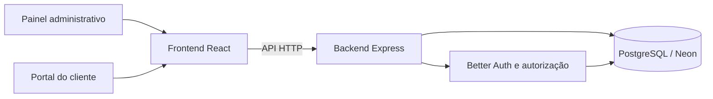

<div align="center">
  <picture>
    <source media="(prefers-color-scheme: dark)" srcset="web/public/brand/funilador-logo-claro.svg">
    <source media="(prefers-color-scheme: light)" srcset="web/public/brand/funilador-logo-escuro.svg">
    
  </picture>
  <h3>Organização, comunicação e gestão de projetos em um só lugar.</h3>
  <p>Meu micro SaaS full-stack desenvolvido no Ateliêzinho.</p>
  <p><strong>Portfólio público · Primeira publicação em preparação</strong></p>
  <p><a href="#funcionalidades">Funcionalidades</a> · <a href="#arquitetura">Arquitetura</a> · <a href="#qualidade-e-segurança">Qualidade</a> · <a href="#desenvolvimento-local">Desenvolvimento</a></p>
</div>

## Sobre o projeto

O Funilador nasceu da minha vontade de reunir em um único lugar todo o processo de fornecer serviços: receber pedidos/solicitações, organizar clientes, negociar propostas e contra propostas, acompanhar o desenvolimento dos projetos, manter controle do financeiro e manter a comunicação centralizada.

O objetivo é reduzir a necessidade de varias ferramentas e oferecer ao profissional e ao cliente uma visão compartilhada do trabalho, respeitando cada um.

É um projeto autoral de aprendizado para meu portfólio, construído com atenção a cada detalhe, pensado na experiência de uso e sua segurança. O código está disponível para consulta no GitHub; se der certo para mim, pretendo deixá-lo fornecido a várias outras pessoas que talvez gostem de uma centralização de serviço, acessível de verdade, transparente e sem um mercenarismo anterior de várias empresas que fazem com que o freelance pareça algo impossível.

## Funcionalidades

| Painel administrativo | Portal do cliente |
| --- | --- |
| Dashboard e acompanhamento de pendências | Dashboard pessoal |
| Gestão de clientes, convites e acessos | Acesso por convite |
| Organização e análise de solicitações | Envio e acompanhamento de solicitações |
| Gestão de projetos, marcos e visibilidade | Acompanhamento de projetos e validação de marcos |
| Propostas e negociação | Consulta e decisão sobre propostas |
| Controle de cobranças e registro de recebimentos | Consulta de informações comerciais disponibilizadas |
| Conversas, mensagens e notificações internas | Comunicação e notificações internas |

O módulo financeiro organiza registros e cobranças. Não representa uma integração com um processador de pagamentos(ainda). O chat utiliza atualização periódica; não é anunciado como comunicação com criptografia ponta a ponta(ainda).

## Experiência visual

Três estilos de interface, com temas claro e escuro e adaptações para desktop e mobile:

- **Minimalista:** foco na clareza e na organização.
- **Moderno:** transições, navegação e interações mais dinâmicas.
- **Expressivo:** maior liberdade visual, animações e apresentação de dados, aqui eu brinquei ao limite.

<!-- Galeria: inserir aqui prints -->

## Stack tecnológica

| Camada | Tecnologias |
| --- | --- |
| Frontend | React, TypeScript, Vite, React Router |
| Interface | Mantine UI, Motion, React Bits, Tabler Icons, Recharts |
| Backend | Node.js, Express, TypeScript |
| Autenticação | Better Auth |
| Banco de dados | PostgreSQL (Neon), node-postgres (`pg`) |
| Qualidade | ESLint, TypeScript, Node.js Test Runner |
| Versionamento | Git e GitHub |

## Arquitetura



O frontend organiza as telas e interações. O backend centraliza as regras e os sistemas essenciais, como a autorização e as operações de persistência. O banco de dados mantém os registros relacionais e as regras de integridade protegidos.

```text
Funilador/
├── api/                 # API, autenticação e regras de negócio
│   ├── src/
│   ├── db/migrations/   # Toda a organização do banco de dados
│   └── test/            # Testes de segurança e integridade do sistema para garantir que nada ta errado
├── web/                 # Aplicação React
│   ├── public/brand/    # Identidade visual em SVG
│   └── src/            # Páginas, componentes, estilos e utilitários
├── licenses/            # Licenças e avisos de terceiros
├── scripts/             # Ferramentas auxiliares
├── LICENSE.md
├── THIRD_PARTY_NOTICES.md
└── README.md
```

## Qualidade e segurança

O projeto adota autenticação por convite(por enquanto só convidando o cliente para ter acesso), controle de acesso por perfil, validações de titularidade dos registros no backend, consultas parametrizadas, restrição de origem em operações de escrita. O banco de dados utiliza uma função de acesso operacional distinta da função administrativa de migração para garantir autenticidade nos pedidos.

- Interface: React + Vite
- Linguagem: Typescript
- Componentes visuais: Mantine UI
- Backend e API: Node.js + Express
- Banco: PostgreSQL

A divisão do código por rotas reduz o tamanho do módulo JavaScript principal. Comparação entre o build anterior à otimização e o build local de 28/11/2026:

| Indicador | Antes | Atual |
| --- | ---: | ---: |
| JavaScript principal | 1.345,75 kB | 467,12 kB |
| JavaScript principal (gzip) | 402,84 kB | 144,13 kB |

Os valores dizem respeito ao chunk principal, não ao total de dados transferidos por uma página. O módulo de gráficos expressivos permanece separado e ainda gera um aviso de tamanho no build por ser muito mais exagerado em varios quesitos.

## Desenvolvimento local

> O repositório público é outra forma de ver a validez do projeto. A execução local descrita abaixo pressupõe autorização de uso e um ambiente de desenvolvimento previamente provisionado. Não há credenciais, contas de demonstração nem dados reais distribuídos neste repositório para fins de exposição.

### Pré-requisitos

- Node.js 24 e npm (ambiente utilizado no desenvolvimento).
- PostgreSQL compatível com as migrações do projeto (ambiente validado: Neon/PostgreSQL 18).
- Banco de desenvolvimento com esquema, permissões e contas de teste configurados.
- Arquivo `api/.env` local, mantido fora do Git, com `DATABASE_URL` da função operacional e `BETTER_AUTH_SECRET` exclusivo de desenvolvimento.

A configuração atual utiliza a origem local `http://localhost:5173`. O provisionamento de um banco novo requer preparação administrativa das funções e aplicação controlada das migrações em `api/db/migrations/`. Não execute a baseline sobre um banco existente.

### Executar

Em um terminal, na raiz do projeto:

```powershell
cd api
npm ci
npm run dev
```

Em outro terminal, a partir da raiz:

```powershell
cd web
npm ci
npm run dev
```

A interface local utiliza `http://localhost:5173`, com encaminhamento de `/api` para o backend em `http://localhost:3001`.

### Verificações locais

Com o backend de desenvolvimento iniciado, na pasta `api`:

```powershell
npx tsc --noEmit 
npm test
```

comando logo a cima serve para validar o estado de comprometimento dos arquivos.

As suítes autenticadas estão em `api/test/`, com os scripts `run-authorization.ps1` e `run-integrity.ps1`. Devem ser executadas exclusivamente em desenvolvimento, com contas fictícias e nunca contra produção.

Na pasta `web`:

```powershell
npm run lint
npm run build
```

## Licenciamento

O código original do Funilador possui direitos autorais reservados. A visibilidade pública do repositório destina-se à apresentação do trabalho e não equivale à concessão de uma licença de código aberto.

Consulte [LICENSE.md](LICENSE.md), [THIRD_PARTY_NOTICES.md](THIRD_PARTY_NOTICES.md) e a [pasta de licenças](licenses/). Bibliotecas e componentes de terceiros permanecem sujeitos às respectivas licenças. Sugestões e feedback sobre o projeto são bem-vindos.

---

<div align="center">
  
  <p><strong>Desenvolvido no Ateliêzinho por Dani.</strong></p>
  <p>Complexidade na construção. Clareza na apresentação. Personalidade na assinatura.</p>
</div>
